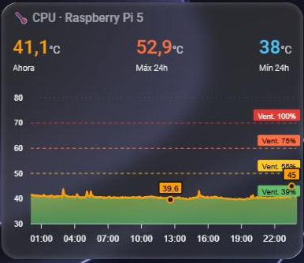
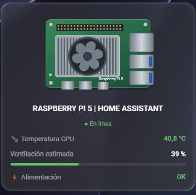
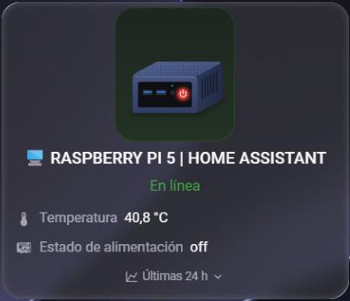

# 🌀 Ventilador PWM silencioso para Raspberry Pi 5 con Home Assistant OS

[English version](README.en.md)

<a href="https://www.paypal.com/ncp/payment/KKLS7UVFFSNZE"></a>

Controla un ventilador **PWM de 5 V** (p. ej. **Noctua NF-A6x15 5V PWM**) conectado al GPIO de una
**Raspberry Pi 5** con **Home Assistant OS**, según la temperatura de la CPU.

- ✅ **Una sola edición de `config.txt`**: sin complementos, sin HACS, sin pigpio, sin scripts.
- ✅ Lo controla el **firmware/kernel**: funciona aunque Home Assistant esté parado o reiniciando.
- ✅ Curva **fresca y silenciosa**, ya probada.
- ✅ Copia de seguridad y **vuelta atrás en 1 minuto** (incluso si la Pi no arranca).
- ✅ Tarjeta de temperatura para el panel de HA.

> ¿Usas el ventilador oficial de la Pi 5 (Active Cooler, conector FAN)? Ese ya lo controla el firmware
> solo; esta guía es para ventiladores conectados a los **pines GPIO**.

---

## 1. Qué necesitas

| | |
|---|---|
| Placa | Raspberry Pi 5 |
| Sistema | Home Assistant OS (SD, SSD o NVMe) |
| Ventilador | 4 pines, **PWM, 5 V** |
| Complemento | [Advanced SSH & Web Terminal](https://github.com/hassio-addons/addon-ssh) (tienda de complementos oficial de la comunidad) |

## 2. Conexión

| Cable Noctua | Función | Pin físico |
|---|---|---|
| 🟡 Amarillo | +5 V | **2** |
| ⚫ Negro | GND | **6** |
| 🔵 Azul | PWM | **12** (GPIO18) |
| 🟢 Verde | Tacómetro | 16 (opcional, no se usa) |

Esquema detallado: [docs/wiring.md](docs/wiring.md).

## 3. Instalación paso a paso

### 3.1 Prepara el terminal
1. **Ajustes → Complementos → Tienda** → instala **Advanced SSH & Web Terminal**.
2. En la pestaña **Configuración** del complemento, pon un usuario/clave o clave SSH (lo pide para arrancar).
3. En la pestaña **Información**, **desactiva «Modo de protección»** y pulsa **Reiniciar**.
   Hace falta para acceder a la partición de arranque. **Lo volverás a activar al final.**
4. Pulsa **Abrir interfaz web**.

### 3.2 Haz una copia de seguridad de `config.txt`
Copia y pega en el terminal:

```sh
docker run --rm -v /mnt/boot:/boot alpine sh -c 'cp -n /boot/config.txt /boot/config.txt.bak && ls -l /boot/config.txt*'
```

Debes ver `config.txt` y `config.txt.bak` con el mismo tamaño.

### 3.3 Añade el ventilador
```sh
docker run --rm -v /mnt/boot:/boot alpine sh -c 'grep -q pwm-gpio-fan /boot/config.txt && echo "YA ESTABA, no toco nada" || printf "%s\n" \
"" \
"# Ventilador PWM 5V en GPIO18" \
"dtoverlay=pwm-gpio-fan,fan_gpio=18" \
"dtparam=fan_temp0=40000,fan_temp0_speed=100" \
"dtparam=fan_temp1=50000,fan_temp1_speed=140" \
"dtparam=fan_temp2=60000,fan_temp2_speed=190" \
"dtparam=fan_temp3=70000,fan_temp3_speed=255" >> /boot/config.txt; sync; tail -n 8 /boot/config.txt'
```

Las últimas líneas mostradas deben ser las del ventilador.

### 3.4 Reinicia la Raspberry
```sh
ha host reboot
```

### 3.5 Comprueba que funciona
Tras el arranque, abre de nuevo el terminal:

```sh
echo "CPU: $(cat /sys/class/thermal/thermal_zone0/temp)"; for h in /sys/class/hwmon/hwmon*; do [ -e $h/pwm1 ] && echo "$(basename $(readlink -f $h/device)): pwm1=$(cat $h/pwm1)"; done
```

- `CPU:` es la temperatura (45000 = 45 °C).
- La línea **`pwm-fan`** es tu ventilador: **0** si la CPU está por debajo de 40 °C, **100** o más por encima.
- La línea `cooling_fan` es el conector oficial de la Pi 5; si no lo usas, ignórala.

### 3.6 Vuelve a activar el «Modo de protección» ✅
Complemento → **Información** → activa **Modo de protección** → **Reiniciar**.

## 4. La curva

| Temperatura CPU | Velocidad | Se apaga / baja al bajar de |
|---|---|---|
| < 40 °C | parado | — |
| 40 °C | 39 % (100) | 35 °C |
| 50 °C | 55 % (140) | 45 °C |
| 60 °C | 75 % (190) | 55 °C |
| 70 °C | 100 % (255) | 65 °C |

Para cambiarla edita los valores `fan_tempN` (milésimas de grado) y `fan_tempN_speed` (0–255).
Opcional: `fan_tempN_hyst` (por defecto 5000 = 5 °C) cambia cuánto debe enfriarse antes de bajar.

### ⚠️ Por qué varias líneas `dtparam=` y no una sola
El firmware de la Raspberry **ignora todo lo que pase de 98 caracteres en una línea de `config.txt`**,
sin dar error. Si pones todos los parámetros en una sola línea `dtoverlay=...`, los últimos se pierden
en silencio y el overlay usa sus valores por defecto (55/60/67,5/75 °C). Las líneas `dtparam=` justo
debajo del `dtoverlay=` se aplican a ese overlay, así que **no pongas otro `dtoverlay=` en medio**.

## 5. Tarjetas para el panel

Antes de nada:
1. Activa la integración **System Monitor** (Ajustes → Dispositivos y servicios → Añadir → System Monitor)
   y habilita el sensor **Temperatura del procesador**.
2. Para la alimentación, añade la integración **Raspberry Pi Power Supply Checker** (avisa si la fuente se queda corta).
3. En cada YAML, cambia `sensor.TU_TEMPERATURA_CPU` y `binary_sensor.TU_ESTADO_ALIMENTACION` por tus
   entidades. Las encuentras en Ajustes → Dispositivos y servicios → Entidades.
4. Añade una tarjeta → **Manual** y pega el YAML.

| Tarjeta | Vista | Requiere (HACS) |
|---|---|---|
| **Curva de temperatura** con las líneas de cada velocidad · [YAML](lovelace/cpu-temp-card.yaml) |  | [apexcharts-card](https://github.com/RomRider/apexcharts-card) |
| **Raspberry animada**: el ventilador del dibujo gira según la temperatura · [YAML](lovelace/button-card.yaml) |  | [button-card](https://github.com/custom-cards/button-card) |
| **Mini PC** con estado, temperatura e historial · [YAML](lovelace/appliance-card.yaml) |  | [HA Appliance Card](https://github.com/ADNPolymerase/ha-appliance-card) |
| **Básica**, sin nada extra · [YAML](lovelace/cpu-temp-card-basic.yaml) | — | nada |

Las esquinas redondeadas (`card_mod`) son opcionales y necesitan [card-mod](https://github.com/thomasloven/lovelace-card-mod);
si no lo tienes, borra ese bloque. Si cambias la curva en `config.txt`, cambia también los mismos valores en las tarjetas.

## 6. Volver atrás

**Con la Pi funcionando** (modo de protección desactivado):
```sh
docker run --rm -v /mnt/boot:/boot alpine sh -c 'cp /boot/config.txt.bak /boot/config.txt && sync' && ha host reboot
```

**Si la Pi no arranca (plan B):**
1. Apágala y conecta la tarjeta SD / SSD a un PC con Windows, Mac o Linux.
2. Abre la unidad **`hassos-boot`** (FAT, se ve sin programas extra).
3. Borra o renombra `config.txt` y **renombra `config.txt.bak` a `config.txt`**.
4. Vuelve a ponerla en la Pi.

> 🚫 Nunca formatees ni borres particiones: solo hay que tocar `config.txt`.

## 7. Problemas frecuentes

| Síntoma | Causa probable |
|---|---|
| `docker: command not found` / permiso denegado | El «Modo de protección» sigue activo, o no reiniciaste el complemento. |
| El ventilador no gira nunca | Cable azul en pin equivocado, CPU por debajo de 40 °C, o ventilador de 12 V. |
| Gira siempre al máximo | Falta el cable PWM (azul) o no está en el pin 12. |
| La curva no es la que puse | ¿Línea de más de 98 caracteres? ¿Otro `dtoverlay=` entre medias? |
| El terminal muestra «403: Forbidden» tras reiniciar | Sesión caducada: ve a otra página de HA y vuelve a abrir el terminal. |
| Zumbido a baja velocidad | El overlay usa PWM por software a 50 Hz. Sube `fan_temp0_speed` (p. ej. 120). |

## 8. Créditos
- Overlay [`pwm-gpio-fan`](https://github.com/herbingk/pwm-gpio-fan) de herbingk, incluido en el firmware oficial de Raspberry Pi.
- Guía probada en Raspberry Pi 5 + Home Assistant OS arrancando desde SSD con un Noctua NF-A6x15 5V PWM.

## ☕ Apoya el proyecto
Si te ha ahorrado tiempo, puedes invitarme a un café 💙 (o usar el botón **💗 Sponsor** de arriba del repositorio). ¡Gracias!

<a href="https://www.paypal.com/ncp/payment/KKLS7UVFFSNZE"></a>

Licencia [MIT](LICENSE).
